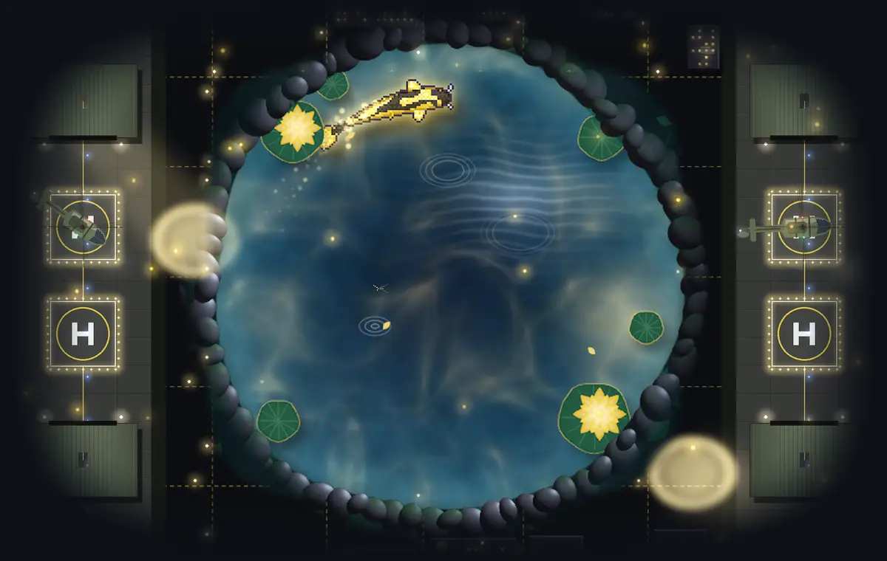

  

  

  

My koi is redrawn every night from my GitHub activity: languages color it, contributions grow it, streaks mark it.

## About

- **Forward Deployed Engineer @ Uniphore**: I ship agent and document-parsing systems for enterprise clients, and I'm on the research team working on evals.
- **Before that, Manifest (now Empirik AI)**: I built a change-observability platform tracking Kubernetes, IAM, database and network changes, led the observability dashboard, and built the RAG layer over client data.
- **Santa Clara University, Computer Science & Engineering**: research on AI agents in microgrids.
- **Goal**: Forward Deployed Engineering in defense.

## Tech

  

## Research

Technical reports from my production work. Each one is grounded in published research, with 27 arXiv papers among its references.

| Report | Context |
| --- | --- |
| [Structure-Preserving Document Ingestion for Enterprise RAG](https://fde-portfolio.onrender.com/#paper-ingestion) | Uniphore, 2026. Parsing heterogeneous files into a document tree, schema-validated summaries and path-aware chunks, plus a benchmark of graph vs. transformer parsers. |
| [Declarative Secret Delivery for AI Microservices on Kubernetes](https://fde-portfolio.onrender.com/#paper-secrets) | Uniphore, 2026. External Secrets Operator for encrypted credentials, zero-downtime rotation and per-service failure isolation. |
| [Agentic Incident Response with Change-Aware Anomaly Detection](https://fde-portfolio.onrender.com/#paper-incident) | Empirik AI, 2025. A LangGraph agent that detects abnormal changes with Isolation Forest, correlates Kubernetes, Datadog and LogicMonitor signals, and gates automated rollback. |

## Projects

| Project | What it is |
| --- | --- |
| [driftguard](https://github.com/Rahul-Kaura/driftguard-) | Pre-deploy change risk for Kubernetes. Builds a dependency graph from manifest diffs, computes blast radius, and returns approve, review or block. |
| [fieldrag](https://github.com/Rahul-Kaura/fieldrag) | Offline document retrieval with citations. Structure-aware chunks find the right passage first 96% of the time vs. 77% for fixed windows, with no network access. |
| [Infrastructure Compliance Scanner](https://github.com/Rahul-Kaura/InfrastructureComplianceScanner) | TypeScript compliance scanner with AI-assisted config drafting. |
| [fde-portfolio](https://fde-portfolio.onrender.com/) | My FDE portfolio: deployments, research and builds. |

## Activity

  <picture>
    <source media="(prefers-color-scheme: dark)" srcset="dist/snake-dark.svg" />
    
  </picture>

  

  
  

  
  

  

  

Koi by <a href="https://github.com/yalongwastaken/git-koi">git-koi</a> · snake by <a href="https://github.com/Platane/snk">snk</a> · cards by <a href="https://github.com/vn7n24fzkq/github-profile-summary-cards">github-profile-summary-cards</a>

