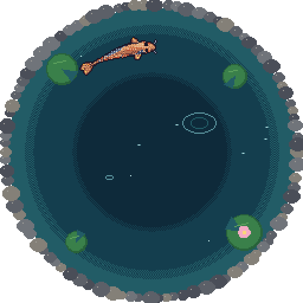

  

  

My koi is redrawn every night from my GitHub activity: languages color it, contributions grow it, streaks mark it.

## About me

- 🛰️ **Forward Deployed Engineer @ Uniphore**: I ship agent and document-parsing systems for enterprise clients, and I'm on the research team working on evals.
- 🔭 **Before that, Manifest (now Empirik AI)**: I built a change-observability platform tracking Kubernetes, IAM, database and network changes, led the observability dashboard, and built the RAG layer over client data.
- ⚡ **Santa Clara University, Computer Science & Engineering**: research on AI agents in microgrids.
- 🎯 **Goal**: Forward Deployed Engineering in defense.

## Tech

  

## Projects

| Project | What it is |
| --- | --- |
| [driftguard](https://github.com/Rahul-Kaura/driftguard-) | Infrastructure drift detection |
| [fieldrag](https://github.com/Rahul-Kaura/fieldrag) | Retrieval-augmented generation for field data |
| [Infrastructure Compliance Scanner](https://github.com/Rahul-Kaura/InfrastructureComplianceScanner) | TypeScript compliance scanner with AI-assisted config drafting |
| [fde-portfolio](https://github.com/Rahul-Kaura/fde-portfolio) | My FDE portfolio site |

## Activity

  <picture>
    <source media="(prefers-color-scheme: dark)" srcset="dist/snake-dark.svg" />
    
  </picture>

  

  
  

  
  

  

  

Koi by <a href="https://github.com/yalongwastaken/git-koi">git-koi</a> · snake by <a href="https://github.com/Platane/snk">snk</a> · cards by <a href="https://github.com/vn7n24fzkq/github-profile-summary-cards">github-profile-summary-cards</a>

