# Theme Preview

Here are all cards with themes.
| :bell: | If only show Top Languages card here, then you maybe forgot to use [Personal access token](https://docs.github.com/en/actions/configuring-and-managing-workflows/creating-and-storing-encrypted-secrets) instead of GITHUB_TOKEN in workflow. |
| :-------: | :------------------------------------------------------------------------------------------------------------------------------------------------------------------------------------------------------------------------------------------------ |

## [great_gatsby](./great_gatsby/README.md)

 
 
